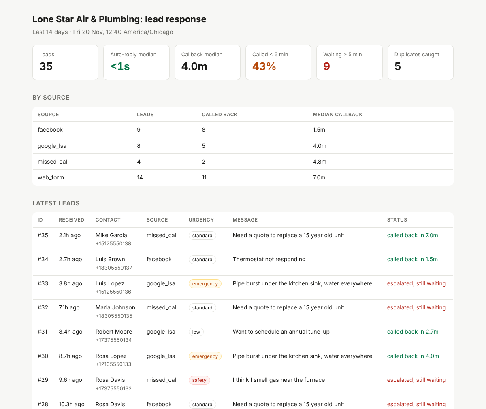
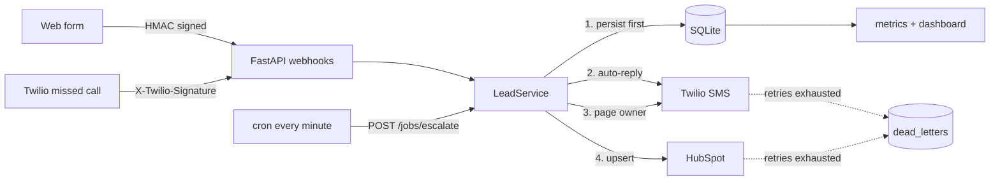

# Speed-to-Lead Engine

[](https://github.com/naraya07pedro-spec/speed-to-lead-engine/actions/workflows/ci.yml)


A small backend that answers every inbound lead for a home-service business (HVAC, plumbing) within seconds, pages the owner when nobody has called the customer back, and shows exactly where leads are leaking.

Built with FastAPI and SQLite. Twilio for SMS and missed calls, HubSpot for CRM sync. Runs fully offline in demo mode.



*Dashboard filled by the built-in simulator. All names and numbers are fake (555-01xx).*

## The problem

A homeowner whose AC dies in July fills in three contact forms and calls two companies. The first business that answers usually gets the job. Small shops lose those leads in boring ways: a call comes in while the tech is on a roof, a form lands in an inbox nobody checks until evening, the same customer is texted three times by three people, or nobody can say how fast the team actually responds.

This service fixes the boring part:

| Step | What happens |
| --- | --- |
| Intake | Web forms, missed calls (Twilio), and any lead source that can send a webhook |
| Normalize | Phone to E.164, email lowercased, whitespace cleaned |
| Idempotency | The same webhook delivered twice creates one lead, not two |
| Dedupe | The same person enquiring again within 24h is attached to the existing lead and **not** texted again |
| Triage | Rule-based urgency: `safety` (gas, CO), `emergency` (no AC, burst pipe, newborn at home), `standard`, `low` |
| Auto-reply | SMS in seconds, worded by urgency and business hours. Gas smell gets "leave the house and call 911 or your gas utility" |
| Owner alert | Emergencies page the owner immediately |
| Escalation | Leads with no human contact after N minutes page the owner. Idempotent, safe to run from several workers |
| CRM sync | Upserts the contact into HubSpot, falls back to update-by-email on conflict |
| Metrics | Median auto-reply time, median human callback time, % called back within 5 minutes, leads still waiting, by source |

## Architecture



The HTTP layer only parses and authenticates. All decisions live in `app/service.py`, which has no web dependency and is tested directly.

More detail, including why each decision was made: [docs/architecture.md](docs/architecture.md).

## Failure modes it handles

- **Provider outage.** The lead is committed before any outbound call. If Twilio or HubSpot is down, the reply is retried with exponential backoff, then written to `dead_letters` with the error. The lead is never lost.
- **Retrying the wrong thing.** HTTP 4xx (except 429) is treated as permanent and not retried. 5xx and 429 are retried.
- **Duplicate webhooks.** Providers retry on timeouts. An idempotency key (provider id when present, payload hash otherwise) makes replays a no-op.
- **Spamming the customer.** Repeat enquiries inside the dedupe window are counted, not re-texted.
- **Double paging.** Escalation claims leads with a single `UPDATE ... RETURNING`, so two workers cannot page the owner twice for the same lead.
- **Forged webhooks.** Form webhooks use HMAC-SHA256 over `timestamp.body` with a 5-minute replay window. Twilio webhooks are checked with Twilio's own signature scheme (tested against the example in Twilio's docs). Outside demo mode an unsigned form webhook is refused.
- **Bad AI output.** The optional LLM classifier can refine urgency but can never downgrade a rule-detected safety or emergency case, and an LLM error falls back to the rules.
- **Time zones.** Business hours are evaluated in the shop's zone (`America/Chicago` by default) with DST handled by `zoneinfo`.
- **XSS.** Every value rendered in the dashboard is HTML-escaped (there is a test for it).

## Quick start

```bash
git clone https://github.com/naraya07pedro-spec/speed-to-lead-engine
cd speed-to-lead-engine
python -m venv .venv && source .venv/bin/activate
pip install -r requirements-dev.txt

uvicorn app.main:create_app --factory --reload
# in another terminal
curl -X POST "localhost:8000/demo/simulate?count=40"
open http://localhost:8000          # dashboard
open http://localhost:8000/docs     # OpenAPI
```

Or with Docker (includes a sidecar that runs escalation every minute):

```bash
cp .env.example .env
docker compose up --build
```

Send a single signed lead:

```bash
python scripts/send_test_lead.py --url http://localhost:8000 --secret "$WEBHOOK_SECRET"
```

## API

| Method | Path | Purpose |
| --- | --- | --- |
| `POST` | `/webhooks/form` | JSON lead from a site form or any webhook source |
| `POST` | `/webhooks/twilio/missed-call` | Twilio call-status or voicemail callback |
| `POST` | `/leads/{id}/touch` | Record the first real human contact |
| `POST` | `/jobs/escalate` | Page the owner about stale leads (run from cron) |
| `GET` | `/leads`, `/leads/{id}` | Leads, with full audit trail on the detail view |
| `GET` | `/metrics?days=14` | Response-time and leakage report as JSON |
| `GET` | `/dead-letters` | Outbound messages that failed after all retries |
| `GET` | `/` | Dashboard |
| `POST` | `/demo/simulate` | Fake traffic (demo mode only) |

Example form payload:

```json
{
  "name": "Maria Garcia",
  "phone": "(512) 555-0142",
  "message": "AC is blowing warm air and it's 101 outside",
  "source": "web_form",
  "submission_id": "form-8812"
}
```

## Configuration

Everything is an environment variable; see [`.env.example`](.env.example). The defaults are a safe demo: console notifier, no CRM, no external calls.

To go live: set `DEMO_MODE=false`, `WEBHOOK_SECRET`, `NOTIFIER=twilio` with credentials, `VERIFY_TWILIO_SIGNATURE=true` and `PUBLIC_BASE_URL`. Sending SMS to US numbers from a local 10-digit number also requires A2P 10DLC registration with Twilio.

## Tests

```bash
pytest --cov
ruff check . && ruff format --check .
```

The suite covers normalization edge cases, urgency rules, DST, signature verification, retry and dead-letter behaviour, dedupe windows, idempotent escalation, metric arithmetic, and the HTTP layer end to end. CI runs it on Python 3.11 to 3.13 and smoke-tests the Docker image.

## Roadmap

Tracked as [issues](https://github.com/naraya07pedro-spec/speed-to-lead-engine/issues). Highlights: Postgres backend, inbound SMS replies counting as a touch, Jobber and Housecall Pro adapters, quiet hours for non-urgent texts, opt-out (STOP) handling, a weekly email report for the owner.

## License

MIT
